# JMR Audio

### Open. Adjust. Mix.

**Free audio plugins for REAPER.**

JMR Audio is a collection of lightweight audio processing plugins designed with one simple philosophy:

**Open the plugin. Make your adjustments. Get back to mixing.**

No unnecessary features. No complicated menus. No hardware emulations.

Just practical audio tools designed for real-world mixing and mastering.

## Our Plugins

**Equalization**
- EQ One
- Master EQ One

**Dynamics**
- Gate One
- Channel Comp
- Buss Comp
- Brickwall One

**Channel Processing**
- Channel Strip One
- Bass Driver One
- Preamp One

**Reverb**
- Room One
- Plate One
- Hall One

**Modulation & Delay**
- Chorus One
- Tap Delay One

## Compatibility

- Cockos REAPER
- JSFX plugin format
- Windows, macOS and Linux where supported by REAPER

## Installation

Installation instructions and download packages will be available in the Releases section.

## Licensing

JMR Audio plugins are distributed as freeware.

Free for personal and commercial audio production.

All rights reserved. Redistribution, repackaging or publication of modified versions requires prior written permission.

See the included license agreement for full terms.

## Support Development

JMR Audio is developed independently and distributed free of charge.

If you enjoy our plugins, you can support future development through voluntary donations.

*Donation link coming soon.*

---
---

## JMR Audio – Plugin Gallery

**Open. Adjust. Mix.**

A collection of 14 free audio plugins for REAPER.

### Plugin Overview

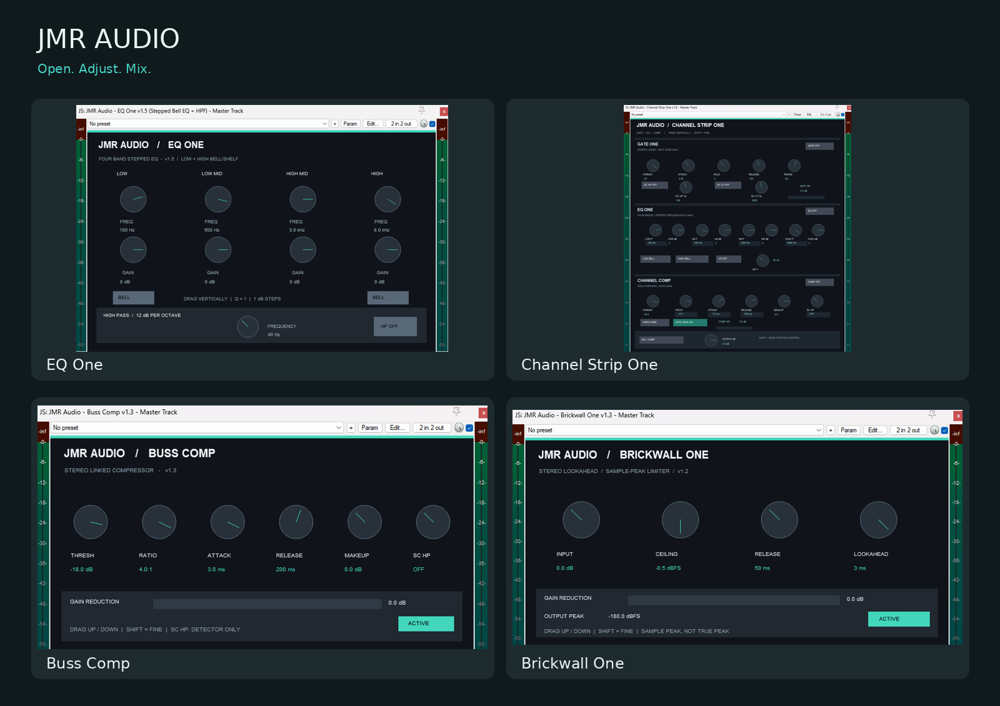

### EQ One
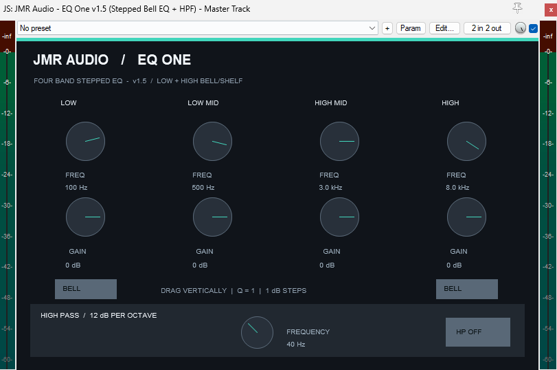

### Master EQ One
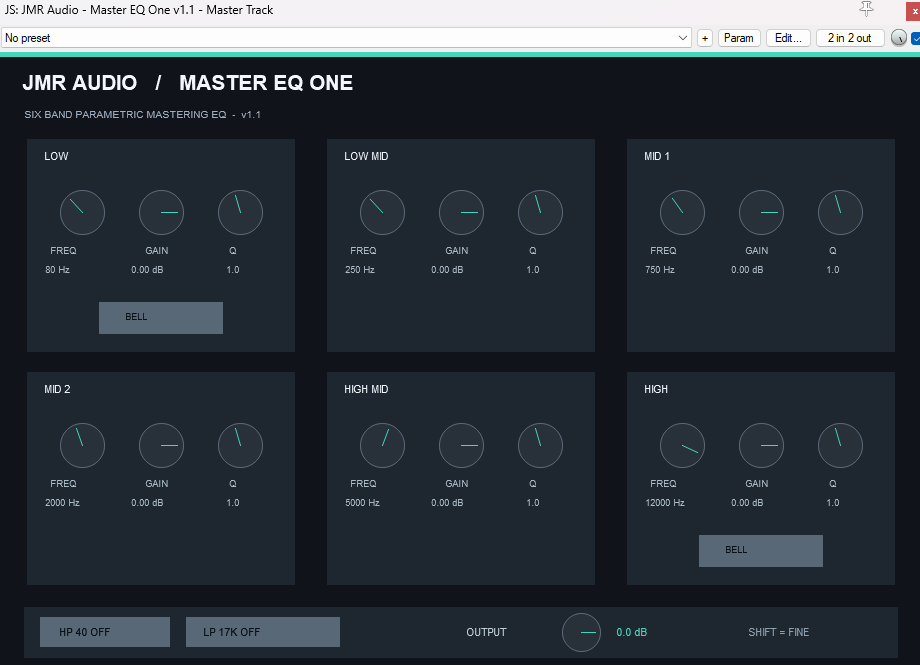

### Gate One
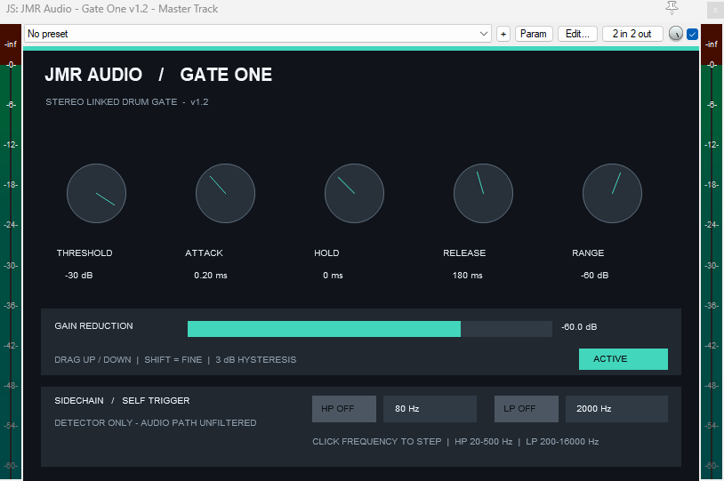

### Channel Comp
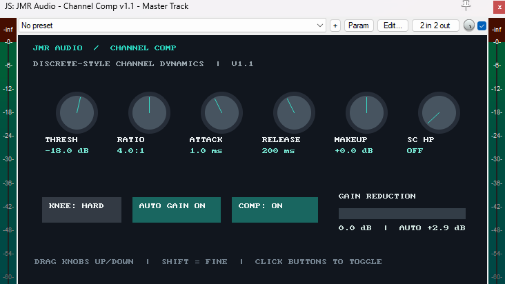

### Buss Comp
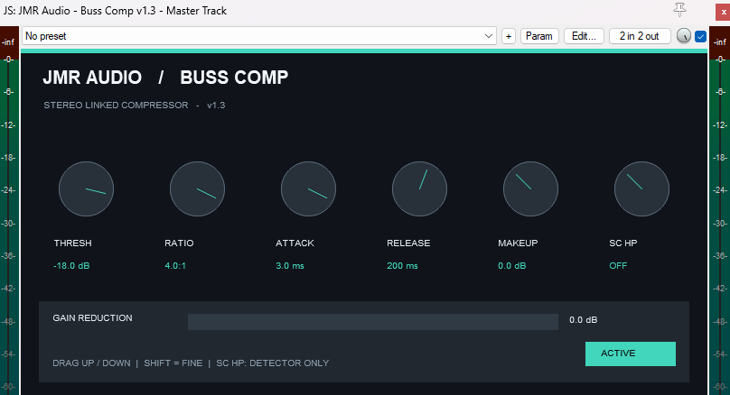

### Brickwall One
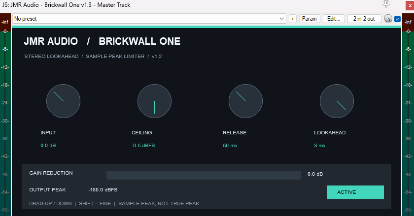

### Channel Strip One
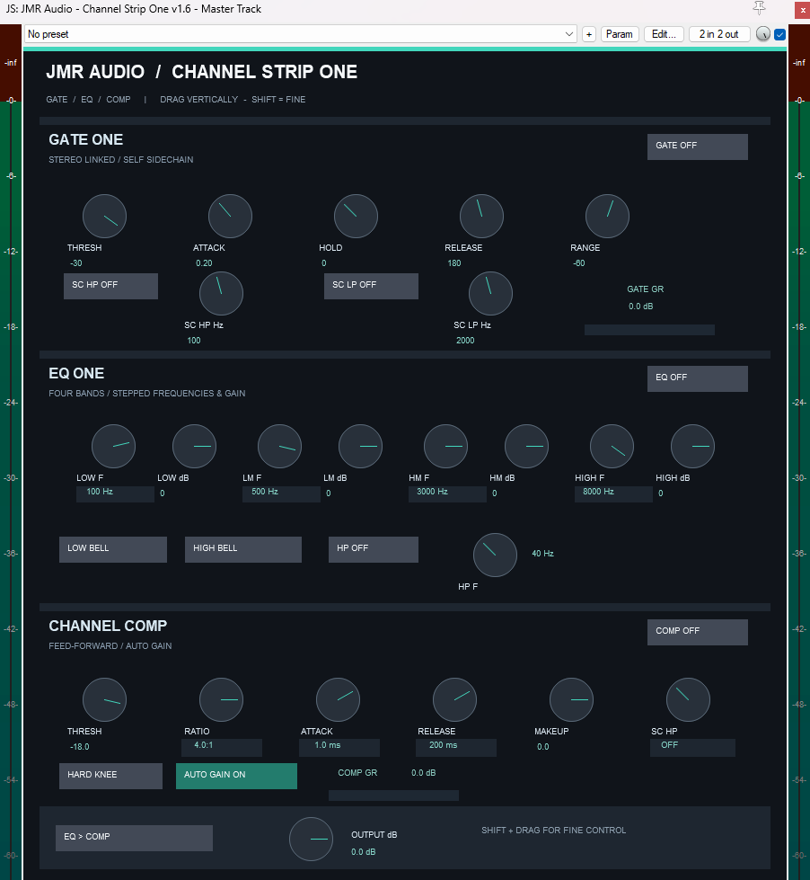

### Bass Driver One
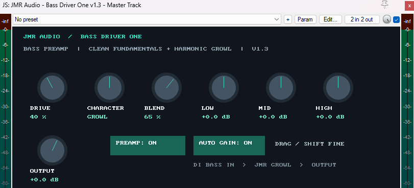

### Preamp One
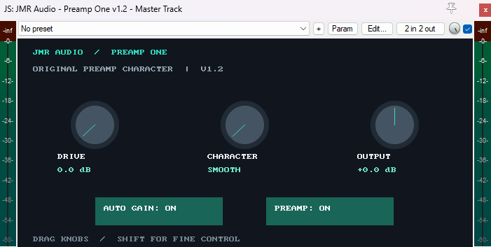

### Room One
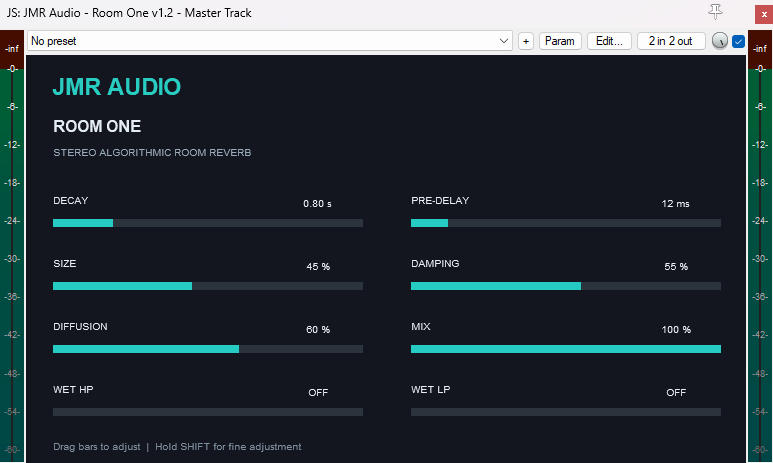

### Plate One
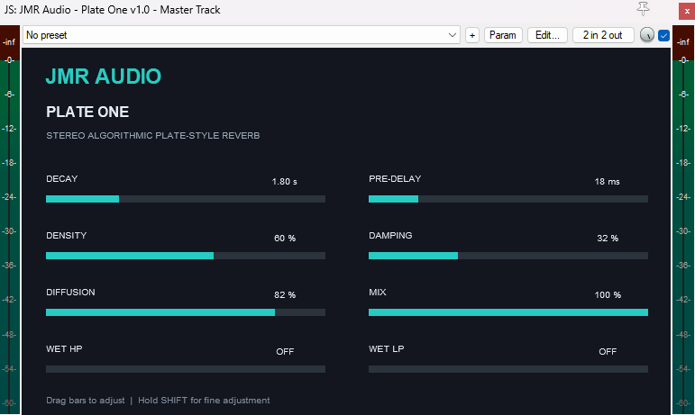

### Hall One
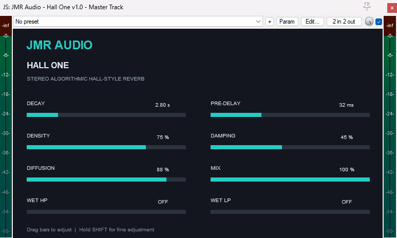

### Chorus One
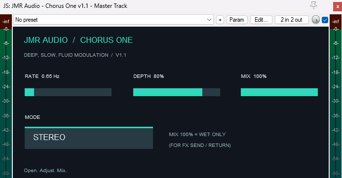

### Tap Delay One
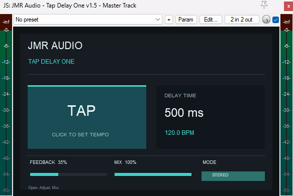

**JMR Audio — Open. Adjust. Mix.**

Copyright © 2026 JMR Audio. All rights reserved.
